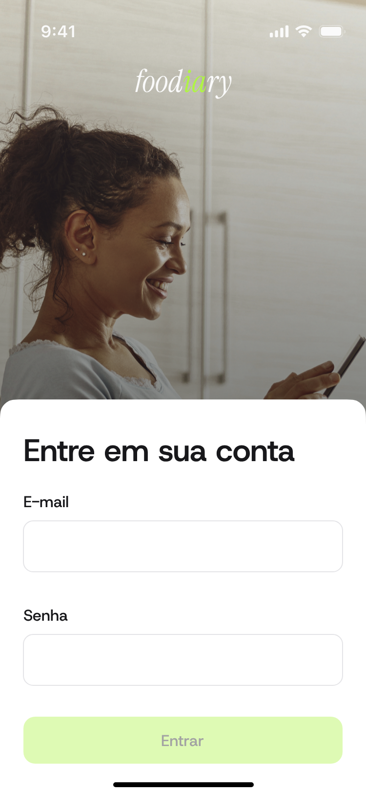
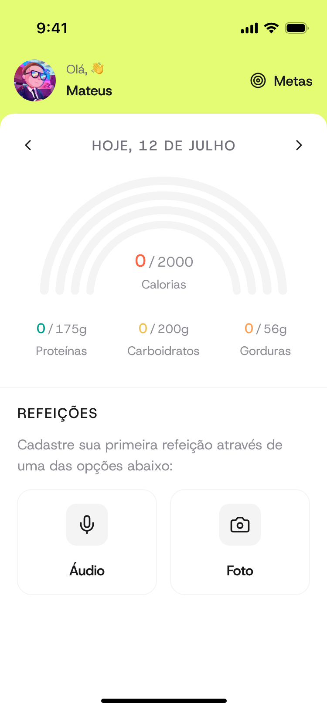
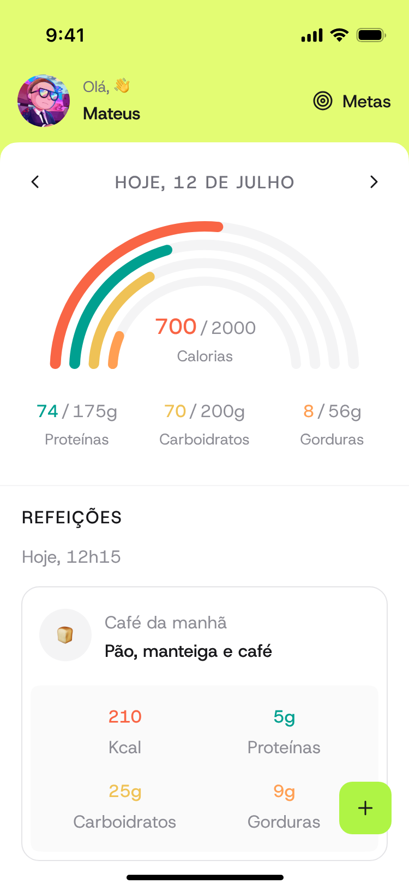
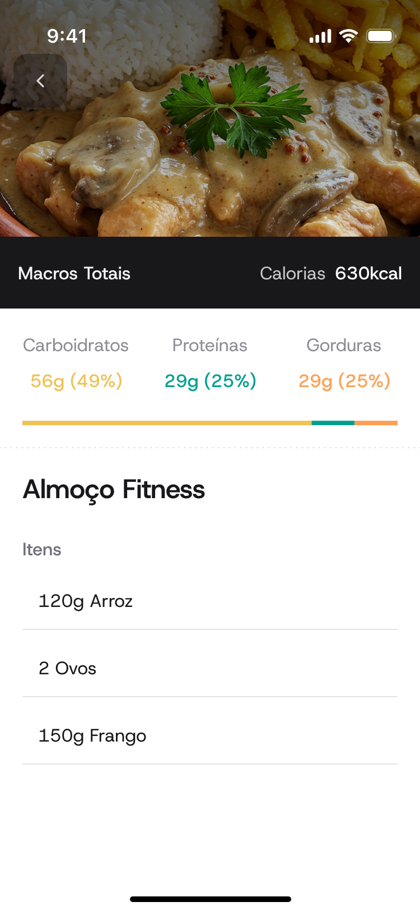
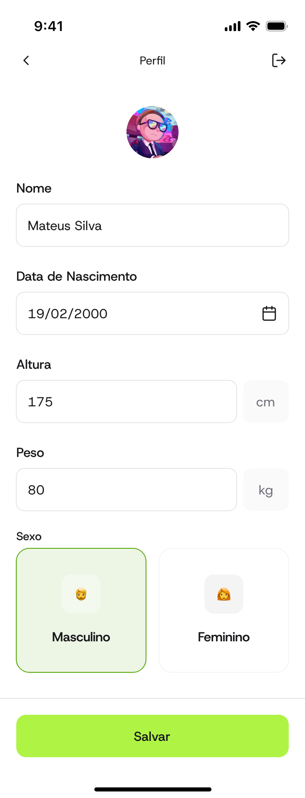
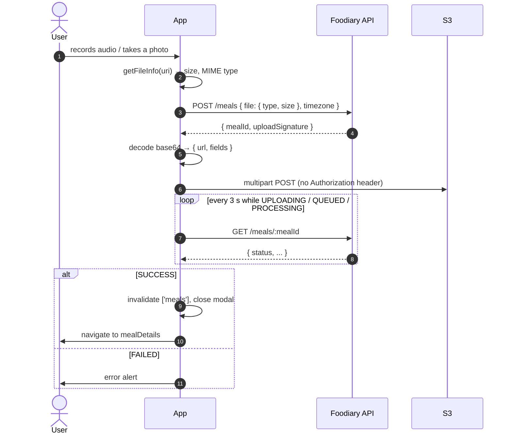
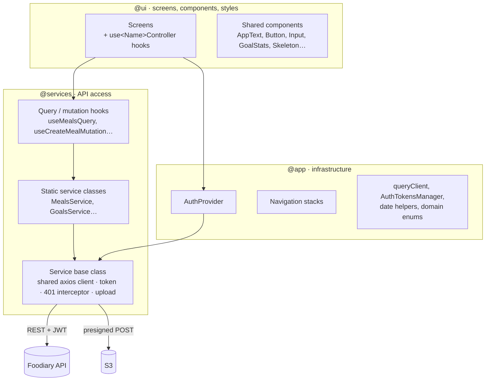
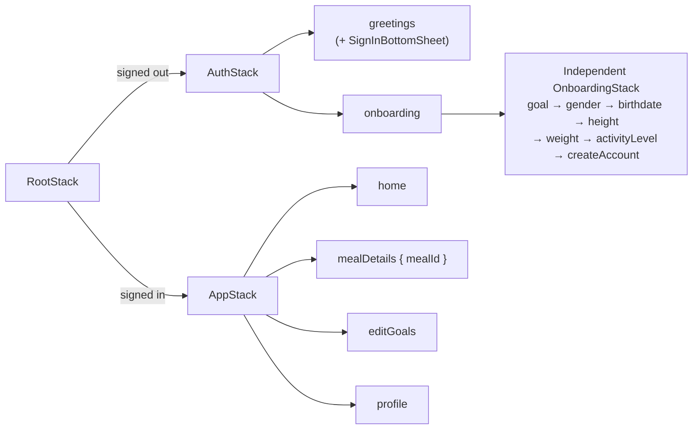

# 🍏 Foodiary App

> A React Native diet tracker where you log meals by **recording a voice note** or **snapping a photo of your plate**. An AI pipeline in the backend identifies the foods and returns calories and macros, and the app tracks your day against personalized goals.


<p align="center">
  
  
  
  
  
</p>

This is the mobile client of **Foodiary**. The interesting part isn't the screens; it's what happens between them. The app has to stay smooth while a meal goes through an asynchronous AI pipeline, keep a session alive across expired tokens, and get calendar dates right across time zones. Highlights:

- **Voice and camera capture** with `expo-audio` and `expo-camera`, uploaded **straight to S3** through a signed POST policy
- **Self-stopping polling** that follows the meal through `UPLOADING → QUEUED → PROCESSING → SUCCESS`
- **Single-flight token refresh**: any number of concurrent `401`s share one refresh request
- **Session-driven navigation**: signing in or out swaps the whole stack, with no imperative redirects
- A **7-step onboarding** built as an independent navigator sharing one validated form
- **Animated SVG goal arcs**, a hand-rolled **Reanimated skeleton** and a **type-safe variants** helper for styles
- **React 19 with the React Compiler**: `use()`, `ref` as a prop, `useEffectEvent`, no `forwardRef`, no manual memoization

---

## 🎯 The problem

Calorie tracking apps fail for one simple reason: **logging food is tedious**. You search a database, guess a portion, and repeat that for every ingredient of every meal. Most people give up within a week.

Foodiary removes the typing:

- 🎙️ **Say what you ate** ("rice, beans and a grilled chicken breast") and the meal is transcribed and analyzed.
- 📸 **Or take a picture of your plate** and each visible food gets an estimated weight and macros.
- 🎯 **Answer six questions** (goal, sex, birth date, height, weight, activity level) and get daily targets for calories, proteins, carbohydrates and fats.
- 📅 **Browse your days** and see each one's progress against your targets.

The AI work happens in the [Foodiary API](https://github.com/oliveiradniel/foodiary-api), a serverless AWS backend. This repository is everything the user touches.

---

## 📱 Screens

|                                              Sign in                                              |                                       Home, empty day                                       |                                      Home, logged meals                                       |
| :-----------------------------------------------------------------------------------------------: | :-----------------------------------------------------------------------------------------: | :-------------------------------------------------------------------------------------------: |
|                                      |              |                      |
| Sign in from a bottom sheet over the landing screen. New users go through the onboarding instead. | Arcs show today's targets. With no meals yet, the audio and photo options are shown inline. | Each arc fills as meals are logged. A floating button opens the same audio and photo options. |

|                                      Meal details                                       |                                             Profile                                              |
| :-------------------------------------------------------------------------------------: | :----------------------------------------------------------------------------------------------: |
|                  |                                   |
| The AI result: meal name, total calories, macro split and every food with its quantity. | Edit name, birth date, height, weight and sex, or sign out. Daily targets have their own screen. |

---

## 🍽️ How a meal is logged

The app never sends the file to the API and never blocks waiting for the AI. It asks for an upload signature, sends the file directly to storage, then polls the meal until the pipeline finishes.



While this runs, the modal plays a looping AI animation (`expo-video`) instead of a spinner.

### Polling that stops on its own

`refetchInterval` is a function of the query's own data, so the query decides when to stop. No timers, no cleanup effects:

```ts
// src/services/MealsService/hooks/useMealQuery.ts
refetchInterval: (query) => {
	const mealStatus = query.state.data?.status;

	if (mealStatus && processingStatuses.includes(mealStatus)) {
		return 3_000;
	}

	return false;
},
```

The modal controllers react to the status change with `useEffectEvent`, so the effect depends only on `meal?.status` while still reading the latest handlers.

---

## 🧱 Architecture

The code is split into three layers, each with its own path alias. UI code never imports axios: it goes through a query or mutation hook, or through `AuthContext`.



### Navigation



Every stack is a typed `createNativeStackNavigator` that exports its `ParamList` plus `NavigationProps`, `ScreenProps<Route>` and `RouteProps<Route>` helpers, so `navigate('mealDetails', { mealId })` is checked at compile time.

---

## 💡 Design decisions

### Concurrent 401s share one refresh

When the access token expires, several requests can fail at the same time. Refreshing once per request would rotate the refresh token several times, and every call but the first would fail. The interceptor keeps **one in-flight promise** that every failing request awaits, then replays each request once:

```ts
// src/services/Service.ts
config._retry = true;

refreshPromise ??= refreshHandler().finally(() => {
	refreshPromise = null;
});

await refreshPromise;

config.headers.delete('Authorization');

return this.client(config);
```

The interceptor skips requests already retried and the `/auth/refresh-token` call itself, so it can't loop. If the refresh fails, the handler signs the user out.

### The session drives navigation

There's no `navigate('app')` anywhere. `RootStack` renders **either** the auth stack **or** the app stack, based on whether the `['account']` query has data. Sign in, sign up and sign out only change the session, and React Navigation animates the swap (`pop` when leaving, `push` when entering). A side effect: screens inside `AppStack` can rely on the account existing.

On startup, `AuthProvider` restores the tokens from AsyncStorage, loads the account and only then hides the splash screen, so there's no flash of the sign-in screen for a returning user.

### Uploading straight to storage, without leaking the token

All API calls share one static axios client that carries the `Authorization` header. The upload uses **plain axios** instead, so the user's JWT is never sent to the storage provider:

```ts
const { url, fields } = JSON.parse(base64.decode(uploadSignature));

const form = new FormData();
for (const [key, value] of Object.entries(fields)) {
	form.append(key, value);
}
form.append('file', file);

await axios.post(url, form, {
	headers: { 'Content-Type': 'multipart/form-data' },
});
```

### Onboarding as an independent navigator with one form

The onboarding steps live in their own `NavigationContainer` inside a `NavigationIndependentTree`, so the header with its progress bar can sit **outside** the step stack and stay still while the steps slide. One `react-hook-form` instance with a single zod schema wraps all seven steps:

- each step validates only its own field with `form.trigger('<field>')` before moving on;
- the last step submits the whole form and calls `signUp`;
- flow order comes from one `orderedSteps` array, not from the order of the screens;
- the progress bar follows the navigator's `state` event, so it stays correct after the **iOS back gesture** and the **Android back button**, which bypass `previousStep()`.

### Calendar days are not instants

Brazil is UTC-3. `new Date('2000-02-19')` parses as UTC midnight, which is **the evening of the 18th** locally. The app treats the two kinds of dates differently:

| Kind             | Example       | Sent as                                  | Read back with   |
| ---------------- | ------------- | ---------------------------------------- | ---------------- |
| Instant          | `createdAt`   | ISO timestamp                            | `new Date()`     |
| Calendar day     | `birthDate`   | `YYYY-MM-DD` via `formatLocalDate`       | `utcToLocalDate` |
| Day being viewed | meals by date | `?date=YYYY-MM-DD` via `formatLocalDate` | n/a              |

Meals are also created with the device's IANA time zone (`Intl.DateTimeFormat().resolvedOptions().timeZone`), so a dinner logged at 11 PM shows up on the right day.

### Data fetching tuned for a single user

- `staleTime: Infinity` and retries off: data changes only when the user changes it, so mutations invalidate exactly what they touch.
- Goal and profile mutations **resolve only after `['account']` refetches**, so the Home screen already shows the new numbers when the user navigates back.
- The meals list uses `keepPreviousData`, so switching days keeps the old list on screen instead of flashing an empty state.

### Small, owned UI primitives

- **Goal arcs** are SVG paths whose `strokeDasharray` is animated from 0 to the percentage of the target: four concentric arcs, for calories, proteins, carbohydrates and fats.
- **`Skeleton`** is a ~100-line Reanimated shimmer (a wide `LinearGradient` translated across the box). It replaced Moti, which imports the `SafeAreaView` deprecated in React Native 0.88.
- **`createVariants`** is a tiny, fully typed variants API (similar in spirit to Stitches) on top of `StyleSheet`, with `VariantProps` inferred for component props:

```ts
// src/ui/components/Button/styles.ts
export const buttonStyles = createVariants({
	base: { alignItems: 'center', justifyContent: 'center', borderRadius: 12 },
	variants: {
		variant: {
			primary: { backgroundColor: theme.colors.lime[500] },
			secondary: { backgroundColor: theme.colors.gray[300] },
			ghost: { backgroundColor: 'transparent' },
			neutral: { backgroundColor: theme.colors.lime['700/5'] },
		},
		size: {
			default: { paddingHorizontal: 24, paddingVertical: 14, minHeight: 52 },
			icon: { width: 48, height: 48 },
		},
		disabled: { true: { opacity: 0.5 }, false: { opacity: 1 } },
	},
	defaultVariants: { variant: 'primary', size: 'default', disabled: 'false' },
});

export type ButtonVariants = VariantProps<typeof buttonStyles>;
// { variant?: 'primary' | 'secondary' | 'ghost' | 'neutral'; size?: …; disabled?: … }
```

### Controller hooks

Logic-heavy screens and components keep state and handlers in a `use<Name>Controller` hook next to them (`useHomeController`, `useAudioModalController`, `useProfileController`). The component only renders what the hook returns, which keeps the JSX readable and the logic easy to test in isolation.

---

## 🗂️ Project structure

```
src/
├── app/                      # @app: non-visual infrastructure
│   ├── config/               #   env, validated at import time
│   ├── contexts/AuthContext/ #   session, token restore, refresh handler
│   ├── lib/                  #   queryClient, token storage, file and date helpers
│   ├── navigation/           #   RootStack, AuthStack, AppStack (typed)
│   └── types/                #   domain enums matching the API (Goal, MealStatus…)
├── services/                 # @services: API access
│   ├── Service.ts            #   shared client, token, 401 interceptor, upload
│   ├── AuthService.ts
│   ├── AccountsService/      #   + useAccountQuery
│   ├── GoalsService/         #   + useUpdateGoalMutation
│   ├── ProfilesService/      #   + useUpdateProfileMutation
│   └── MealsService/         #   + useMealsQuery, useMealQuery, useCreateMealMutation
└── ui/                       # @ui: everything visual
    ├── App.tsx               #   fonts, providers, navigation
    ├── components/           #   shared components (AudioModal, PictureModal, GoalStats…)
    ├── screens/              #   Greetings, Onboarding, Home, MealDetails, EditGoals, Profile
    ├── styles/               #   theme tokens and createVariants
    └── utils/                #   formatters and macro calculations
```

---

## 🚀 Production stack

| Technology                         | Role                                                         |
| ---------------------------------- | ------------------------------------------------------------ |
| **Expo SDK 58**                    | Native modules, config plugins, splash screen and fonts      |
| **React Native 0.88 + React 19**   | UI runtime, with the **React Compiler** enabled              |
| **React Navigation 7**             | Typed native stacks, nested independent onboarding navigator |
| **TanStack Query 5**               | Server state, cache, polling and invalidation                |
| **Axios**                          | HTTP client with a refresh token interceptor                 |
| **React Hook Form + Zod 4**        | Forms and validation                                         |
| **expo-audio / expo-camera**       | Recording meals by voice or photo                            |
| **expo-video**                     | Looping animation while the AI processes a meal              |
| **expo-file-system**               | File size and metadata before upload                         |
| **Reanimated 4 + Gesture Handler** | Animations and gestures                                      |
| **@gorhom/bottom-sheet**           | Sign-in sheet                                                |
| **react-native-svg**               | Goal progress arcs                                           |
| **AsyncStorage**                   | Token persistence                                            |
| **Lucide**                         | Icons                                                        |

## 🧪 Development stack

| Technology            | Use                                     |
| --------------------- | --------------------------------------- |
| **TypeScript** strict | Path aliases `@app`, `@services`, `@ui` |
| **oxlint**            | Fast linting                            |
| **Prettier**          | Formatting (tabs, single quotes)        |
| **pnpm**              | Package management                      |

---

## 📄 Environment variables

| Name                  | Description                  | Example                                                |
| --------------------- | ---------------------------- | ------------------------------------------------------ |
| `EXPO_PUBLIC_API_URL` | Base URL of the Foodiary API | `https://xxxxxxxx.execute-api.sa-east-1.amazonaws.com` |

The variable is validated when the app starts. If it's missing or not a valid URL, the app throws right away instead of failing on the first request.

---

## ▶️ Running the project

### Prerequisites

- Node.js and **pnpm**
- The [Foodiary API](https://github.com/oliveiradniel/foodiary-api) deployed (see its README)
- [Expo Go](https://expo.dev/go) on your phone, or an Android emulator / iOS simulator

### Setup

```bash
git clone https://github.com/oliveiradniel/foodiary-app.git
cd foodiary-app

pnpm install

cp .env.example .env   # set EXPO_PUBLIC_API_URL

pnpm start             # scan the QR code, or press a / i for a simulator
```

### Useful commands

```bash
pnpm start                     # start the dev server
pnpm android                   # open on Android
pnpm ios                       # open on iOS
pnpm lint                      # oxlint
pnpm typecheck                 # tsc --noEmit
pnpm exec prettier --write .   # format
pnpm dlx expo-doctor           # check dependency and config issues
```

---

## ⚠️ Known limitations & next steps

These are the trade-offs I'm aware of, listed honestly:

- **No automated tests yet.** Controller hooks and the date and macro helpers are the natural first targets, followed by component tests for the meal flow.
- **Meal status comes from polling.** Push notifications or WebSockets on `SUCCESS`/`FAILED` would save requests and let the user leave the modal while the AI works.
- **The audio and photo controllers duplicate the status handling.** Extracting a `useMealProcessing` hook would remove it.
- **No password recovery in the app.** The API already has `/auth/forgot-password`; the screens are missing.
- **Updating the profile doesn't recalculate the goals.** The user can edit the goals manually, but an opt-in "recalculate" action would be nicer.
- **Light mode and Portuguese only.** Dark mode and i18n aren't implemented.

---

## 🛜 Backend

This app consumes the **[Foodiary API](https://github.com/oliveiradniel/foodiary-api)**: AWS Lambda, API Gateway, Cognito, DynamoDB single-table, S3 + CloudFront, and an SQS pipeline that runs the meals through OpenAI with structured outputs.

---

## 🧑🏻‍💻 Check out my other projects

### Production

- [JungleOps](https://jungleops.com.br/cadastro?redirect=%2Ftarefas): real-time team task management.
- [InOrbit](https://app.inorbit.site/login): weekly goal tracking with gamification.

### Repositories

- [Foodiary API](https://github.com/oliveiradniel/foodiary-api): the serverless, event-driven backend of this app.
- [Opaque Refresh Tokens with Redis](https://github.com/oliveiradniel/opaque-refresh-tokens-redis): JWT + opaque refresh tokens with rotation, theft detection, and atomic Lua scripts.
- [LetMeAsk](https://github.com/oliveiradniel/letmeask.web): Q&A with RAG over audio content.
- [Neural Book Rec](https://github.com/oliveiradniel/neural-book-rec.web): book recommendations with neural networks.
- [ForgePlan](https://github.com/oliveiradniel/forgeplan-web): industrial production planning and inventory.

---

## 👤 Author

**Daniel Oliveira**

[](https://www.linkedin.com/in/kadadniel/)
[](https://kadadev.com.br/)
